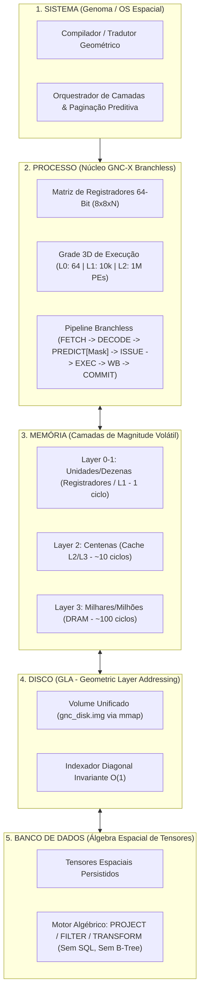

# GNC-X: Formalização Algébrica Matricial e Especificação do Simulador Virtual Unificado
**Sistema $\rightarrow$ Processo $\rightarrow$ Memória $\rightarrow$ Disco $\rightarrow$ Banco de Dados**

**Autor da Concepção:** Zaqueu Ribeiro da Costa  
**Documento:** Especificação Formal de Arquitetura, Crivos Invariantes, Primologia e Simulador Virtual (v1.0)  
**Referências Base:**
- [GNC-X - O Genoma Computacional Espacial (Whitepaper).pdf](file:///C:/Users/orieb/Documents/Geometric_Computer/GNC-X%20-%20O%20Genoma%20Computacional%20Espacial%20(Whitepaper).pdf)
- [Infográfico Arquitetural GNC-X](file:///C:/Users/orieb/Documents/Geometric_Computer/Gemini_Generated_Image%20(1).jpeg)

---

## 1. Visão Geral e Princípio de Isomorfismo Estrutural

A tese fundamental da arquitetura **GNC-X (*Geometric Navigational Core Architecture*)** é que **todo o ecossistema computacional deve obedecer à mesma estrutura algébrica matricial**. Em vez de traduzir dados entre abstrações incompatíveis (registradores escalares $\rightarrow$ endereços lineares de RAM $\rightarrow$ blocos de sistema de arquivos NTFS/EXT4 $\rightarrow$ árvores B-Tree de bancos de dados), a GNC-X estabelece um **Isomorfismo Espacial Unificado**:

$$\mathcal{G}_{\text{Sistema}} \cong \mathcal{G}_{\text{Processo}} \cong \mathcal{G}_{\text{Memória}} \cong \mathcal{G}_{\text{Disco}} \cong \mathcal{G}_{\text{DB}}$$

Onde cada domínio é apenas uma **Camada de Magnitude ($L_k$)** dentro da mesma grade geométrica tridimensional, governada pelos **Crivos Invariantes Diagonais** e operada pelo **Genoma** sem desvios condicionais (*branchless*).

---

## 2. Formalização Matemática: Camadas de Magnitude e Crivos Invariantes Diagonais

### 2.1. Espaço de Camadas de Magnitude Decimal ($L_k$)
O espaço computacional é particionado em camadas discretas de ordem de grandeza decimal $L_k$, onde $k \in \{0, 1, 2, \dots, N\}$ representa a profundidade da camada:

* **$L_0$ (Unidades — $10^1$):** Domínio $[0, 9]$
* **$L_1$ (Dezenas — $10^2$):** Domínio $[00, 99]$
* **$L_2$ (Centenas — $10^3$):** Domínio $[000, 999]$
* **$L_3$ (Milhares — $10^4$):** Domínio $[0000, 9999]$
* **$L_k$ (Magnitude $10^{k+1}$):** Domínio $[0, 10^{k+1}-1]$

### 2.2. O Crivo Invariante de Referência (A Diagonal Principal)
Em cada camada $L_k$, a grade espacial possui uma espinha dorsal imutável: a **Diagonal de Dígitos Idênticos (*Repdigits*)**. Ela é gerada pelo **Repunit** de ordem $k+1$:

$$R_{k+1} = \frac{10^{k+1} - 1}{9} = \sum_{i=0}^{k} 10^i = \underbrace{11\dots1}_{k+1 \text{ dígitos}}$$

Os **10 Pontos de Ancoragem do Crivo Invariante** na camada $L_k$ são definidos pelo operador diagonal $\mathcal{D}(k, d)$:

$$\mathcal{D}(k, d) = d \cdot R_{k+1}, \quad d \in \{0, 1, 2, 3, 4, 5, 6, 7, 8, 9\}$$

| Índice ($d$) | $L_0$ ($R_1 = 1$) | $L_1$ ($R_2 = 11$) | $L_2$ ($R_3 = 111$) | $L_3$ ($R_4 = 1111$) | Camada Geral $L_k$ |
| :---: | :---: | :---: | :---: | :---: | :---: |
| **0** | `0` | `00` | `000` | `0000` | $0 \cdot R_{k+1}$ |
| **1** | `1` | `11` | `111` | `1111` | $1 \cdot R_{k+1}$ |
| **2** | `2` | `22` | `222` | `2222` | $2 \cdot R_{k+1}$ |
| **3** | `3` | `33` | `333` | `3333` | $3 \cdot R_{k+1}$ |
| **...** | ... | ... | ... | ... | ... |
| **7** | `7` | `77` | `777` | `7777` | $7 \cdot R_{k+1}$ |
| **9** | `9` | `99` | `999` | `9999` | $9 \cdot R_{k+1}$ |

### 2.3. Propriedades de Invariância e Navegação *Layer-by-Layer*
1. **Invariância Topológica de Escala:** Independentemente da grandeza (seja $10^2$ na cache L1 ou $10^{12}$ no disco), cada camada possui exatamente **10 pivôs diagonais simétricos** que particionam a camada em setores geométricos idênticos.
2. **Operador de Transição Vertical (Elevação e Projeção de Camada):**
   $$\mathcal{D}(k+1, d) = 10 \cdot \mathcal{D}(k, d) + d$$
   $$\mathcal{D}(k-1, d) = \left\lfloor \frac{\mathcal{D}(k, d)}{10} \right\rfloor$$
3. **Decomposição por Resíduo Geométrico Diagonal:**
   Qualquer elemento, estado ou endereço $X \in L_k$ é endereçado não por varredura linear, mas como um vetor de coordenadas relativas aos crivos invariantes de cada camada:
   $$X = \sum_{i=0}^{k} s_i \cdot \mathcal{D}(i, d_i), \quad s_i \in \{-1, 0, +1\}$$
   Onde $d_k$ seleciona o pivô diagonal na camada $k$ e o resíduo $\Delta_{k-1} = X - s_k \mathcal{D}(k, d_k)$ é projetado recursivamente para a camada inferior $L_{k-1}$.

---

## 3. Primologia, Grandezas, Profundidade Operacional e Segurança

A organização do espaço em **Camadas de Magnitude ($L_k$)** ancoradas por **Crivos Invariantes Diagonais ($d \cdot R_{k+1}$)** abre uma fundação matemática direta para **Primologia**, **Profundidade Operacional** e **Segurança Estrutural**:

### 3.1. Primologia e Crivos Estruturais por Grandeza
1. **Fatoração Intrínseca da Diagonal (*Repunits*):**
   * Para $k \ge 1$, todo elemento da diagonal principal $\mathcal{D}(k, d) = d \cdot R_{k+1}$ com $d > 1$ é **estruturalmente composto** (divisível por $d$ e por $R_{k+1}$).
   * Os únicos candidatos a primos sobre a própria geratriz diagonal são os **Primos Repunit** ($d=1$, quando $k+1$ é primo, como $R_2 = 11$, $R_{19}$, $R_{23}$, etc.).
   * Portanto, a diagonal funciona como uma **barreira/crivo algébrico exato de números compostos** ($\text{mod } R_{k+1}$, $\text{mod } 3$, $\text{mod } 9$, $\text{mod } 11$, $\text{mod } 37$, $\text{mod } 101$, etc., dependendo da paridade e divisores de $k+1$).
2. **Geometria dos Primos Fora da Diagonal:**
   * Como os múltiplos dos fatores de $R_{k+1}$ se distribuem em retas paralelas e simétricas à diagonal principal em cada camada $L_k$, os números primos ficam confinados a **corredores geométricos determinísticos** (zonas de exclusão de múltiplos) relativos ao crivo diagonal $\mathcal{D}(k, d)$.
   * Em vez de testar divisibilidade sequencialmente (Crivo de Eratóstenes linear), o crivo na GNC-X opera por **projeção de máscaras geométricas (`PREDICATE_MASK`)** camada por camada ($L_0 \rightarrow L_1 \rightarrow L_2 \dots$).

### 3.2. Profundidade Operacional e Segurança Geométrica
1. **Endereçamento e Isolamento por Coordenada Algébrica:**
   * Nenhum processo acessa "ponteiros brutos" de memória linear (eliminando *buffer overflows* e *out-of-bounds reads* clássicos da arquitetura de von Neumann). Todo acesso exige uma tupla algébrica válida $(k, d_k, \Delta_{k-1}, \dots, \Delta_0)$.
2. **Criptografia e Assinatura por Trajetória de Camadas:**
   * A trajetória de decomposição de um estado através das camadas $(L_k \leftrightarrow L_0)$ sob transformações de crivos primos e rotações na Matriz 64-bit funciona como uma **função de permutação espacial de alta difusão**, executável em hardware/SIMD em tempo constante (*branchless*).
3. **Imunidade a *Timing Attacks* e *Speculative Execution Attacks* (Spectre/Meltdown):**
   * Como o pipeline GNC-X opera com **`PREDICTOR DISABLED`** (sem *branch prediction* especulativo condicional e com latência determinística de `1 CYC/STAGE`), canais laterais baseados em tempo de desvio (*branch timing side-channels*) são estruturalmente eliminados.

> [!NOTE]
> **Espaço Reservado para Expansão do Autor (Primologia & Segurança):**
> Esta seção está estruturada para receber suas regras específicas de filtragem primológica, simetrias de grandezas e protocolos de segurança operacional para codificarmos diretamente nos operadores do Simulador.

---

## 4. Arquitetura Unificada do Simulador Virtual GNC-X

Para validar experimentalmente a arquitetura em computadores atuais sem fabricação de silício, o **Simulador Virtual GNC-X** implementa as **5 camadas do ecossistema** usando exatamente o mesmo núcleo matricial:



### 4.1. Camada 1: `SISTEMA` (O Genoma)
* **Papel:** Substitui o escalonador e o gerenciador de memória/arquivos do SO tradicional por um **Orquestrador Algébrico de Camadas**.
* **Mecanismo:** Recebe programas em Bytecode GNC-X (LMIs), mantém a tabela de **Crivos Invariantes Diagonais** pré-computada para todas as magnitudes ativas e gerencia o fluxo preditivo entre Disco (`L4`) $\leftrightarrow$ RAM (`L3`) $\leftrightarrow$ Cache (`L2/L1`) $\leftrightarrow$ Matriz 64-bit (`L0`).

### 4.2. Camada 2: `PROCESSO` (Pipeline *Branchless* & Matriz 64-Bit)
* **Matriz de Registradores 64-Bit (`8x8`):**
  * Cada registrador GNC-X não é apenas um inteiro escalar, mas um plano matricial $8 \times 8$ de bits/palavras que permite operações de máscara, transposição e comparação simultânea contra os pivôs diagonais $\mathcal{D}(k, d)$.
* **Grade 3D Hierárquica:**
  * `Layer 0`: 64 ALUs/MACs de alta complexidade.
  * `Layer 1`: 10.000 unidades vetoriais.
  * `Layer 2`: 1.000.000 PEs simples (simulados em blocos contíguos alinhados para vetorização SIMD/AVX2/AVX-512 ou multithreading).
* **Conjunto de Instruções (Bytecode LMI):**
  * `LDI R_dst, LAYER[k, d, delta]` — Carrega dado usando coordenada do crivo diagonal $(k, d, \Delta)$.
  * `STI LAYER[k, d, delta], R_src` — Armazena dado na coordenada espacial correspondente.
  * `SIEVE_PROJ R_dst, R_src, k` — Decompõe um valor/vetor em relação ao Crivo Invariante Diagonal da camada $k$ em 1 ciclo *branchless*.
  * `PREDICATE_MASK M_dst, R_a, R_b, COND` — Gera máscara de bits 64-bit sem `if/else` (zero *branch misprediction*).
  * `OP_GRID LAYER_DST, LAYER_SRC1, LAYER_SRC2, OP, MASK` — Executa operação matricial/vetorial massiva sobre uma camada inteira condicionada pela máscara.

### 4.3. Camada 3: `MEMÓRIA` (Alocador Geométrico por Magnitude)
* Um espaço contínuo e alinhado em fronteiras de *cache line* (64 bytes), dividido fisicamente nas camadas $L_0, L_1, L_2, L_3$.
* Cada célula é endereçada diretamente pela função de mapeamento geométrico:
  $$\text{Addr}(k, d, \Delta) = \text{Base}(L_k) + d \cdot \text{Stride}_{\text{diag}}(k) + \text{Offset}(\Delta)$$
* O simulador contabiliza com precisão os **ciclos simulados** ($1\text{ ciclo}$ para $L_0/L_1$, $10\text{ ciclos}$ para $L_2$, $100\text{ ciclos}$ para $L_3$) e os **ciclos reais de CPU (nanossegundos)** para validação científica.

### 4.4. Camada 4: `DISCO` (Motor GLA — `gnc_disk.img`)
* **Sem Sistema de Arquivos:** Um arquivo binário único (`gnc_disk.img`) mapeado diretamente no espaço de endereçamento via `mmap` (zero cópia de kernel).
* **Paginação Preditiva Guiada pela Diagonal:** Quando o Processo acessa a âncora diagonal $\mathcal{D}(k, d)$ na camada $k$, o motor GLA calcula instantaneamente a projeção vertical $\mathcal{D}(k+1, d) = 10 \cdot \mathcal{D}(k, d) + d$ no disco e pré-carrega a vizinhança geométrica para a RAM antes da próxima instrução.

### 4.5. Camada 5: `BANCO DE DADOS` (Motor de Álgebra Espacial)
* **Sem Tabelas, Sem SQL, Sem B-Trees:** Os dados persistidos no `gnc_disk.img` já estão organizados naturalmente por camada de magnitude $L_k$ e pivô diagonal $d \in \{0..9\}$.
* **Operadores Algébricos Nativos:**
  * `PROJECT(Layer_Src, Sieve_Mask) -> Layer_Dst`: Filtra e projeta milhões de registros em uma única passagem SIMD *branchless*.
  * `LOCATE_BY_SIEVE(Value)`: Localiza qualquer registro em $O(1)$ decompondo o valor pelo Crivo Invariante Diagonal, em vez de percorrer $O(\log N)$ níveis de ponteiros em uma B-Tree.

---

## 5. Plano de Testes e Validação Empírica (Benchmarks de Prova de Conceito)

Para **validar de fato a ideia**, o Simulador Virtual executará uma bateria automatizada de **4 Testes Comparativos (GNC-X vs. Arquitetura Tradicional)**:

| Teste de Validação | Abordagem Tradicional (Baseline) | Abordagem GNC-X (Simulador) | Métrica de Sucesso |
| :--- | :--- | :--- | :--- |
| **Teste 1: Execução *Branchless* vs. *Branching*** | Loop condicional `if/else` sobre milhões de elementos com dados imprevisíveis | Pipeline GNC-X com `PREDICATE_MASK` + `OP_GRID` sobre a Matriz 64-bit | Redução drástica de ciclos e eliminação de *branch mispredictions* |
| **Teste 2: Navegação & Crivo Primológico/Numérico** | Busca linear / divisão por tentativa / crivo sequencial | Decomposição por Crivo Invariante Diagonal $\mathcal{D}(k, d) = d \cdot R_{k+1}$ (*layer by layer*) | Complexidade $O(1)$ de localização de camada/setor e filtragem em paralelo |
| **Teste 3: Persistência GLA vs. Filesystem** | Leitura/escrita fragmentada em múltiplos arquivos/blocos via I/O tradicional | Acesso algébrico direto em `gnc_disk.img` via `mmap` + prefetch diagonal | Maior vazão (MB/s) e menor latência de acesso por coordenada |
| **Teste 4: DB Espacial vs. Busca em Índice (B-Tree/SQL)** | Busca por chave e filtragem com estrutura de árvore (`B-Tree` / `std::map` / SQLite) | Consulta algébrica `PROJECT(LAYER, SIEVE_FILTER)` direto sobre o tensor espacial | Speedup de ordens de magnitude em consultas de faixa/magnitude e transformações |

---

## 6. Arquitetura de Código Proposta para o Simulador

Podemos construir o simulador de forma modular no diretório `c:\Users\orieb\Documents\Geometric_Computer`:

```text
Geometric_Computer/
├── GNC-X_Especificacao_Formal_e_Simulador.md   # Este documento de especificação
├── gncx_sim/                                   # Núcleo do Simulador Virtual Unificado
│   ├── core_sieve.py (ou .rs / .cpp)           # Matemática de Camadas Lk, Repunits R_{k+1} e Crivos Diagonais
│   ├── register_matrix.py                      # Matriz 64-bit (8x8) e Pipeline Branchless (PREDICATE_MASK)
│   ├── memory_layers.py                        # Hierarquia L0..L3 com contadores de ciclos e Alocador Geométrico
│   ├── gla_disk.py                             # Motor de Disco (gnc_disk.img via mmap) e Paginação Preditiva
│   ├── spatial_db.py                           # Motor de Banco de Dados Tensorial (PROJECT / FILTER sem SQL)
│   ├── genome_vm.py                            # Interpretador/Runtime do Bytecode LMI (Sistema -> Processo)
│   └── benchmarks.py                           # Suíte de testes validando Sistema -> Processo -> Memória -> Disco -> DB
```
