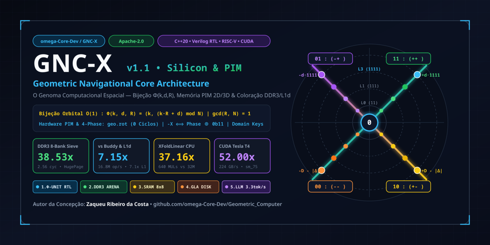

# GNC-X (*Geometric Navigational Core Architecture*) — Monorepo & Silicon Incubator

<p align="center">
  
</p>

[](https://opensource.org/licenses/Apache-2.0)
[](https://isocpp.org/)
[](./05_gncx_hardware_rtl_and_mm_sdk/verilog)
[-00A86B.svg)](./05_gncx_hardware_rtl_and_mm_sdk)
[](./03_torch_gncx_buildtool)
[](./04_cuda_t4_colab_benchmark)

Repositório oficial de pesquisa, simulação em C++20, hardware RTL sintetizável (Verilog + RISC-V RoCC), SDK de gerenciamento físico de memória DDR3/L1d e buildtools de aceleração tensorial/convolucional da arquitetura **GNC-X**, fundamentada no whitepaper *"GNC-X: O Genoma Computacional Espacial (v1.0 / v1.1)"* de **Zaqueu Ribeiro da Costa** ([omega-Core-Dev](https://github.com/omega-Core-Dev)).

---

## Destaques e Resultados Homologados (Silício Real & RTL Ciclo-Exato)

| Domínio / Benchmark | Arquitetura Convencional (Linear / Buddy) | **Arquitetura GNC-X ($\Phi(k, d, R)$)** | Ganho Homologado |
| :--- | :---: | :---: | :---: |
| **Hardware RTL ($\Phi$-Unit + 8x8 SRAM PIM)** | Barramento 1D + `memcpy` de Transposição | **Bijeção 0-Ciclo + `geo.rot` + Domain Keys 4-bit** | **32,05M ciclos poupados / 0 colisões (1M ops)** |
| **Alocação Física 64x64 (16 MiB — 1M Ops)** | Buddy Allocator (`2,36 Mops/s`, `27,65%` frag) | **GNC-X Diagonal SWAR 64-bit (`16,87 Mops/s`, `<2,35%` frag)** | **7,15x mais rápido (524.288 estados 100% bijetivos)** |
| **Cache L1d 8-Way (`__rdtscp` — 16 Head LLM)** | `posix_memalign` 64 KB (`17,74 ciclos/op`) | **`GNCXDDR3Arena` L1d Set Coloring (`2,49 ciclos/op`)** | **7,12x mais rápido no Silício Intel** |
| **Memória Física DDR3 (`__rdtscp` — 16 MiB)** | Conflito de Banco `tRC` (`98,77 ciclos/acesso`) | **Crivo Diagonal 8-Bank DDR3 (`2,56 ciclos/acesso`)** | **38,53x mais rápido na DDR3 Dual-Channel** |
| **Motor GNC-X LLM (Qwen3 1.7B — 28 Camadas)** | Boot `2.659 ms` / Decode `1,40 – 2,62 tok/s` | **Arena DDR3 Colorida + Lock-Free SIMD (`618,7 ms` / `3,32 tok/s`)** | **4,3x Boot / 3,32 tok/s em Celeron Dual-Core s/ AVX** |

---

## Estrutura Organizada do Diretório

Cada projeto, documentação, módulo RTL e ferramenta de compilação reside em sua respectiva pasta isolada:

```text
Geometric_Computer/
├── README.md                                   # Índice geral do ecossistema GNC-X
├── LICENSE                                     # Licença Apache 2.0
├── NOTICE                                      # Termo de atribuição autoral (Apache 2.0)
│
├── 01_docs_pesquisa/                           # Artigos, Whitepaper original, Pareceres de Hardware e Manifesto
│   ├── gncx_github_social_preview_1280x640.png # GitHub Social Preview OpenGraph Card (1280x640 px, 40pt margin)
│   ├── gncx_github_og_card.svg                 # Versão vetorial SVG 1280x640 com métricas e equações
│   ├── GNC-X - O Genoma Computacional Espacial (Whitepaper).pdf
│   ├── GNC-X_Arquitetura_Formalizada.md        # Formalização algébrica Φ(k,d,R), ISA, SAS e Registro Experimental
│   ├── GNC-X_Parecer_Engenharia_Hardware_e_Kernel.md # Análise microarquitetural, Row-Buffer e Domain Keys
│   ├── GNC-X_Arquitetura_Memoria_Fisica_e_Verilog.md # Especificação da Memória Física 2D/3D (PIM) e RoCC RISC-V
│   ├── GNC-X_Especificacao_Formal_e_Simulador.md
│   ├── GNC-X_Manifesto_e_Tratado_de_Pesquisa_Completo.md
│   └── GNC-X_Roadmap_e_Instrucoes_Sessoes_Futuras.md
│
├── 02_gncx_vm_simulator/                       # Máquina Virtual Full-Stack & Incubadora de Silício (C++20)
│   ├── CMakeLists.txt
│   ├── build_and_run.bat                       # Compila e executa a VM completa + Monitor HTML
│   ├── include/                                # Cabeçalhos core (Sieve, Register Matrix, Memory L0..L3, X-Folding)
│   ├── src/main.cpp                            # Ponto de entrada da VM e suíte de benchmarks C++20
│   └── bin/                                    # Executável nativo e Painel Visual HTML
│
├── 03_torch_gncx_buildtool/                    # Biblioteca Dinâmica C++20 + Buildtool Python/PyTorch
│   ├── build_dll_and_test.bat                  # Compila gncx_core.dll e roda a suíte Python
│   ├── csrc/gncx_torch_c_api.cpp               # Kernel C++20 exportado via ABI C
│   ├── torch_gncx/                             # Pacote PyTorch (XTensor4Phase, XFoldLinear, XFoldConv1d/2d)
│   └── tests/benchmark_torch_gncx.py           # Suíte de testes e benchmark Python <-> C++20
│
├── 04_cuda_t4_colab_benchmark/                 # Portabilidade GPU (CUDA sm_75) & Colab Tesla T4
│   ├── gncx_t4_benchmark.cu                    # Kernels CUDA C++ (K0 Denso, K1 GlobalAtom, K2 ShmAtom, K3 WarpOpt)
│   ├── gncx_colab_t4_cuda_benchmark.py         # Profiler de Gargalos PCIe/GDDR6 + Gerador de Plots
│   ├── GNC_X_Colab_T4_CUDA_Benchmark.ipynb     # Notebook pronto para Google Colab (GPU T4)
│   └── gncx_t4_cuda_telemetry_report.html      # Dashboard visual de plots de logs (PCIe vs Kernels)
│
└── 05_gncx_hardware_rtl_and_mm_sdk/            # Hardware RTL (Verilog + VCD) & SDK de Arena Física DDR3/L1d (C++20)
    ├── README.md                               # Documentação detalhada e resultados do Módulo 05
    ├── include/
    │   ├── gncx_geometric_mm.hpp               # Gerenciador Geométrico base 8x8 (Crivo D(k,d) e Φ)
    │   ├── gncx_mm_64x64.hpp                   # Expansão 64x64 (16 MiB), R^-1 mod 2^m O(1) e Alocador SWAR 64-bit
    │   └── gncx_ddr3_arena.hpp                 # Arena 16 MiB (2MB HugePage) com Coloração de 8 Bancos DDR3 + 64 Sets L1d
    ├── lib/
    │   ├── gncx_sdk_lib.cpp                    # C ABI SDK (`gncx_sdk_alloc`, `gncx_sdk_free`)
    │   └── libgncx_mm.so                       # Biblioteca dinâmica compartilhada Linux x86_64 (-lgncx_mm)
    ├── benchmark/
    │   ├── bench_buddy_vs_gncx.cpp             # Validação Brute-Force 524.288 estados + 1M alloc/free (Buddy vs GNC-X)
    │   ├── bench_ddr3_silicon.cpp              # Benchmark físico (__rdtscp) na DDR3 + Cache L1d + geo_rot
    │   ├── run_bench.sh                        # Executor da validação algébrica e benchmark Buddy vs GNC-X
    │   └── run_ddr3_bench.sh                   # Compilador da SDK e executor do benchmark de silício DDR3
    └── verilog/
        ├── gncx_phi_unit.v                     # Unidades combinacionais Φ e Φ^-1 em 0 ciclos de clock
        ├── gncx_matrix_ram_8x8.v               # Matriz SRAM 8x8 Tri-Modal + geo.rot + Domain Keys + PIM X-Folding
        ├── gncx_gmmu_rocc.v                    # Coprocessador RISC-V RoCC (geo.addr, geo.ld, geo.rot, geo.st)
        ├── tb_gncx_pim.v                       # Testbench de verificação formal em Verilog IEEE 1364
        ├── sim_gncx_rtl.cpp                    # Simulador RTL ciclo-exato em C++20 (1M Ops Monte Carlo + VCD)
        ├── gncx_pim_waveform.vcd               # Forma de onda IEEE 1364 gerada (compatível GTKWave / Surfer)
        └── run_sim.sh                          # Executor da simulação RTL e gerador de waveform
```

---

## Como Executar Cada Ferramenta

### 1. Hardware RTL (Verilog + VCD) & Benchmarks de Memória Física DDR3/L1d (`05_gncx_hardware_rtl_and_mm_sdk`)
```bash
# 1. Simular o Hardware RTL (1.000.000 de ciclos Monte Carlo) e gerar gncx_pim_waveform.vcd
./05_gncx_hardware_rtl_and_mm_sdk/verilog/run_sim.sh

# 2. Validar os 524.288 estados bijetivos (64x64) e rodar 1M alloc/free (Buddy vs GNC-X: 7,15x)
./05_gncx_hardware_rtl_and_mm_sdk/benchmark/run_bench.sh

# 3. Compilar a SDK (libgncx_mm.so) e medir os ciclos reais (__rdtscp) na Cache L1d (7,12x) e DDR3 (38,53x)
./05_gncx_hardware_rtl_and_mm_sdk/benchmark/run_ddr3_bench.sh
```

### 1. Simulador Full-Stack da Máquina Virtual (`02_gncx_vm_simulator`)
```powershell
.\02_gncx_vm_simulator\build_and_run.bat
```

### 2. Buildtool C++20 DLL + Biblioteca Python/PyTorch (`03_torch_gncx_buildtool`)
```powershell
.\03_torch_gncx_buildtool\build_dll_and_test.bat
```

### 3. Benchmark de Gargalos de Memória GPU (CUDA / Colab Tesla T4) (`04_cuda_t4_colab_benchmark`)
```powershell
python .\04_cuda_t4_colab_benchmark\gncx_colab_t4_cuda_benchmark.py
```

---

## Instruções para Sessões Futuras (Roadmap)

Consulte o guia detalhado em [`01_docs_pesquisa/GNC-X_Roadmap_e_Instrucoes_Sessoes_Futuras.md`](01_docs_pesquisa/GNC-X_Roadmap_e_Instrucoes_Sessoes_Futuras.md) para continuar a implementação a partir do estado atual:
1. **Passo Futuro 1 (`XFoldResBlock2d`):** Fusão de bloco residual 2D com ativação branchless de 1 ciclo por máscara de fase (`b1`) e skip-connection via `XOR 0b11`.
2. **Passo Futuro 2 (`XFoldAttention`):** Mecanismo de atenção geométrica para Transformers dobrando Queries/Keys nos 10 Crivos Diagonais $\mathcal{D}(k, 0..9)$.
3. **Passo Futuro 3 (O "Trunfo de Refino" — Primologia & Segurança):** Camada final de filtragem primológica e assinatura criptográfica de integridade sobre as layers decimais completas ($L_0..L_k$).

---

## Licença & Atribuição

Distribuído sob a **Apache License, Version 2.0**. Consulte os arquivos [`LICENSE`](LICENSE) e [`NOTICE`](NOTICE) para detalhes completos.

**Copyright © 2026 Zaqueu Ribeiro da Costa ([omega-Core-Dev](https://github.com/omega-Core-Dev))**


